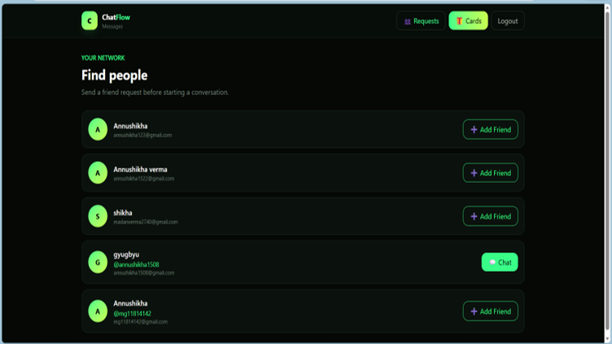

# Chat App | Real-Time Communication Platform

A full-stack chat application designed to bring messaging, voice calls, video calls, file sharing, and interactive card sharing into one platform.

**Live Demo:** https://chat-app-annushikha.vercel.app  
**GitHub Repository:** https://github.com/Annushikha2211/CHAT-APP

## Features

- **User Authentication:** Sign up and log in to the application.
- **User Search:** Find other users to start conversations.
- **Real-Time Messaging:** Exchange messages with other users.
- **Online Status:** View user availability.
- **Typing Indicators:** See when another user is typing.
- **Voice Calls:** Communicate through audio calls.
- **Video Calls:** Communicate through video calls.
- **File Sharing:** Send images and other supported files.
- **Interactive Card Sharing:** Create and send custom cards within conversations.
- 
## Screenshots

### Login Screen




## Tech Stack

### Frontend
- React
- TypeScript
- Vite
- Tailwind CSS
- Axios
- React Router
- Socket.IO Client

### Backend
- Node.js
- Express.js
- TypeScript
- MongoDB
- Mongoose
- Socket.IO
- JWT Authentication
- Multer for file uploads

## Project Structure

```text
CHAT-APP/
├── frontend/
│   ├── src/
│   ├── public/
│   └── package.json
├── backend/
│   ├── src/
│   └── package.json
├── .gitignore
└── README.md
```

## Getting Started

### Prerequisites
- Node.js and npm
- MongoDB database
- Git

### 1. Clone the repository

```bash
git clone https://github.com/Annushikha2211/CHAT-APP.git
cd CHAT-APP
```

### 2. Install backend dependencies

```bash
cd backend
npm install
```

Create a backend `.env` file using the environment variable names required by the application.

### 3. Start the backend

```bash
npm run dev
```

### 4. Install and start the frontend

Open a second terminal from the project root:

```bash
cd frontend
npm install
npm run dev
```

Configure the frontend API URL and production environment variables according to the project configuration.

## Testing

- Test registration and login.
- Search for another user and exchange messages using two accounts.
- Verify online status and typing indicators.
- Test voice and video calls between two users.
- Send and receive images, files, and custom cards.
- Test the deployed application on desktop and mobile.

## Deployment

- **Frontend:** Vercel
- **Backend:** Configure the production backend URL.
- **Database:** MongoDB

Use secure environment variables for production credentials. Never commit `.env` files, passwords, database credentials, or authentication secrets.

## Future Improvements

Potential improvements include stronger automated testing, enhanced error handling, accessibility improvements, and further performance optimization.

## Author

**Annushikha Verma**

- GitHub: https://github.com/Annushikha2211
- LinkedIn: https://www.linkedin.com/in/annushikha-verma-099449326/
